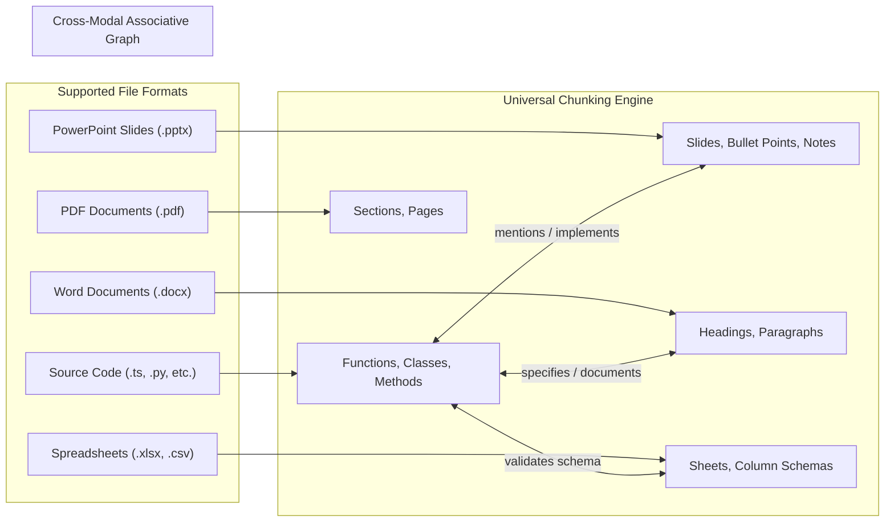

# START HERE: Hivemind Context MCP Backend

Welcome to the **Hivemind Context Engine** repository.

This project is a token-lean Model Context Protocol (MCP) server that equips AI coding agents with hierarchical context trees, sub-file Abstract Syntax Tree (AST) chunking, task-aware file/chunk prioritization, explainable context selection, universal document ingestion, and persistent graph caching.

---

## 1. Project Summary

* **Objective**: Maximize useful work per token; prevent agents from wasting context windows on whole-file dumps and speculative grepping.
* **Protocol**: Model Context Protocol (MCP) over **Server-Sent Events (SSE)** (for remote cloud hosting) and **Stdio** (for local CLI execution).
* **Storage**: Isolated SQLite database in Write-Ahead Logging (WAL) mode per tenant (`.hive/tenants/<tenantId>.db`) for zero cross-tenant leakage.
* **Intelligence**: WebAssembly Tree-sitter AST chunker + local ONNX embeddings (`@xenova/transformers`, `bge-small-en-v1.5`, zero external API calls) + SQLite FTS5 lexical ranking.
* **Scope**: **100% Backend Engine**. No frontend/UI overhead.
* **Scale**: **No Repository Size Cap** — streams files sequentially with batch SQLite commits, effortlessly indexing monorepos and multi-gigabyte codebases.
* **Security**: Ephemeral GitHub tokens held strictly in volatile RAM, in-flight secrets redaction, rate limiting, and Helmet security headers.

---

## 2. Multi-Format Support and Associative Navigation



Rather than forcing AI agents to guess file paths, Hivemind computes associative next-hop reading paths based on cognitive relation weights:

$$w_{\text{specifies}} = 0.95, \quad w_{\text{implements}} = 0.92, \quad w_{\text{calls}} = 0.88, \quad w_{\text{tests}} = 0.80, \quad w_{\text{mentions}} = 0.75$$

Every response includes a 3-line pointer footer ($\approx 40$ tokens) indicating the next logical files to inspect, paired with the dedicated `next(node, task)` tool.

---

## 3. Toolchain Prerequisites

Ensure the following runtimes are installed:
* **Node.js**: `v20.x` or higher (`node -v`)
* **Package Manager**: `npm` (v10+) or `pnpm` (`npm -v` / `pnpm -v`)
* **Git**: Installed and configured (`git --version`)
* **Operating System**: Windows, Linux, or macOS (all native extensions use pre-built binaries or WASM to eliminate native C++ compiler requirements).

---

## 4. Monorepo Architecture and Package Ownership

```
Hive/
├── packages/
│   ├── types/          # SHARED: Master TypeScript contracts and DTOs
│   ├── core/           # KOMAL: Storage (SQLite WAL), Tree-sitter AST, Document Chunker, Git Impact
│   ├── pack/           # ANJALI: Ranker, Local Embeddings, Knapsack Compiler, Next-Hop, ROI Ledger
│   └── mcp/            # JASH: MCP Server (Stdio & SSE), 11 Tools, Window Protocol, Cloud Gateway
├── .hive/
│   ├── overrides.json  # Context pins (force_include / force_exclude)
│   ├── tenants/        # Multi-tenant isolated databases (git-ignored)
│   └── sessions/       # Shared AI session logs (tracked with every push)
├── Dockerfile          # Production hardened multi-stage container
├── render.yaml         # Free Render deployment blueprint
└── scripts/
    ├── ai-session-logger.js    # Pre-push git validation hook
    └── test-e2e-simulation.ts  # End-to-end multi-agent test suite (13/13 passing)
```

### Team Responsibilities and AI Directives
* **Jash (Project Lead / MCP Protocol and Cloud)**:
  * Owns `packages/mcp`, `packages/types`, Docker, Render deployment, and `scripts/`.
  * Directive: `docs/prompts/jash.md`
* **Anjali (Context and Intelligence Specialist)**:
  * Owns `packages/pack`.
  * Directive: `docs/prompts/anjali.md`
* **Komal (Data Engine and AST Specialist)**:
  * Owns `packages/core`.
  * Directive: `docs/prompts/komal.md`
* **Synthesis Integrator (Release Engineer)**:
  * Directive: `docs/prompts/final-merge.md`

---

## 5. Development and Testing Commands

```bash
# 1. Install all dependencies across the monorepo
npm install

# 2. Build all packages
npm run build

# 3. Run individual package test suites
npm test -w @hivemind/core    # Tested by Komal
npm test -w @hivemind/pack    # Tested by Anjali
npm test -w @hivemind/mcp     # Tested by Jash

# 4. Run End-to-End Multi-Agent Simulation (13 Invariants)
node scripts/test-e2e-simulation.ts

# 5. Start Hosted MCP SSE Server Locally
npm run start:sse -w @hivemind/mcp
```
