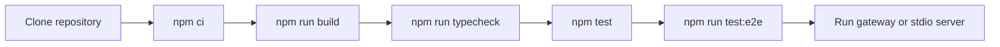

# Start Here

Hivemind Context Engine is a Model Context Protocol server that indexes repositories into a hierarchical graph and returns task-aware, token-budgeted context packs. It ships with a hosted HTTP gateway, a browser graph UI, and a stdio server for offline work.

This page is the contributor entry point. Product and operator documentation is linked at the bottom.

---

## 1. What is in this repository

| Package | Responsibility |
|---|---|
| `packages/types` | Shared TypeScript contracts and constants |
| `packages/core` | SQLite storage, AST and document chunking, graph export, ignore rules, redaction |
| `packages/pack` | Ranking, optional embeddings, knapsack compilation, next-hop prediction, overrides, ROI |
| `packages/mcp` | MCP server, 14 tools, indexer, hosted gateway, graph UI |

Supporting files:

```text
Dockerfile                  Multi-stage production image
render.yaml                 Render cloud blueprint
scripts/e2e-smoke.mjs       End-to-end integration suite
scripts/verify-hosted-tools.mjs  Live-link verifier for all tools and REST surfaces
docs/                       Deployment, usage, and zero-install guides
```

---

## 2. Development workflow



### Prerequisites

- Node.js 20 or newer
- npm 10 or newer
- Git on `PATH`

### Commands

```bash
# Install exactly what the lockfile specifies
npm ci

# Build all four packages in dependency order
npm run build

# Typecheck the workspace
npm run typecheck

# Unit and MCP protocol tests
npm test

# Real end-to-end run: indexing, memory tools, stdio, hosted gateway
npm run test:e2e
```

Current verification on `main`: build and typecheck pass, 60 unit and protocol tests pass, 11 end-to-end checks pass, and the hosted-link verifier passes 21 checks against a live server.

---

## 3. Run the server locally

The local gateway is for development and verification. Production hosting is documented in [docs/HOSTING.md](docs/HOSTING.md).

```bash
HIVE_API_KEY=dev-key \
HIVE_EMBEDDINGS=off \
HIVE_DATA_ROOT=./.hive-dev \
PORT=3000 \
npm run start:sse
```

Endpoints:

- `http://localhost:3000/mcp?tenantId=default`
- `http://localhost:3000/sse?tenantId=default`
- `http://localhost:3000/graph?tenantId=default`
- `http://localhost:3000/health`

Run the stdio server against a repository:

```bash
node packages/mcp/dist/main.js --repo /absolute/path/to/project --no-embeddings
```

Open the MCP Inspector against the stdio server:

```bash
npm run inspector
```

---

## 4. Repository map

```text
packages/
  types/src/index.ts          Contracts, constants, DTOs
  core/src/db.ts              SQLite schema, WAL setup, CAS helpers
  core/src/ast/chunker.ts     Tree-sitter chunking for TS, TSX, JS, JSX, Python
  core/src/docs/              PDF, PPTX, DOCX, XLSX, CSV, Markdown ingestion
  core/src/links/             Cross-modal document-to-code linking
  core/src/git/               Working-tree impact analysis
  core/src/security/          Secret redaction
  pack/src/ranker.ts          Intent classification and composite scoring
  pack/src/knapsack.ts        Bi-level clustered budget compiler
  pack/src/next-hop.ts        Associative navigation
  mcp/src/tools.ts            Tool schemas and dispatch
  mcp/src/context-service.ts  Pack, search, memory, coordination
  mcp/src/indexer.ts          Local and Git repository indexing
  mcp/src/sse-server.ts       Hosted gateway and REST surfaces
  mcp/src/ui/graph.html       Interactive graph UI
```

---

## 5. Documentation

| Document | Purpose |
|---|---|
| [README.md](README.md) | Product overview, architecture, tool catalog, deployment |
| [docs/PLUG-AND-PLAY.md](docs/PLUG-AND-PLAY.md) | Zero-install cloud deployment and manual invocation of every tool |
| [docs/HOSTING.md](docs/HOSTING.md) | Render, Docker, persistence, environment variables, troubleshooting |
| [docs/MCP_USAGE.md](docs/MCP_USAGE.md) | Agent workflow, budgets, ranking semantics, failure modes |
| [SECURITY.md](SECURITY.md) | Security model, controls, limitations, disclosure |

---

## 6. Contribution rules

- Run `npm run build`, `npm run typecheck`, `npm test`, and `npm run test:e2e` before opening a pull request.
- Keep the tool surface at 14 tools unless the change includes schemas, tests, and documentation.
- Do not commit `.env`, tenant databases, cloned repositories, or generated graph exports.
- Treat indexed repository content as untrusted data in tests and examples.
- Keep documentation aligned with the implemented behavior, including known limitations.
