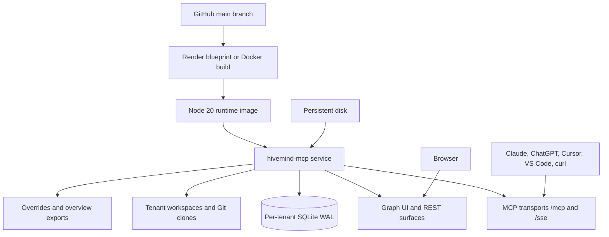

# Hosting Hivemind

Hivemind exposes one MCP server through three transports:

| Transport | Endpoint | Use when |
|---|---|---|
| Streamable HTTP | `POST /mcp?tenantId=<id>` | Remote clients, custom agents, and most modern MCP hosts |
| Legacy SSE | `GET /sse?tenantId=<id>` and `POST /messages` | Older MCP clients that only implement SSE |
| stdio | `node packages/mcp/dist/main.js` | Local, offline, single-developer use |

The tool surface is identical on all three. Choose one transport per client, not both.

---

## 1. Deployment topology



The service runs entirely on the cloud host. No local process is required for hosted clients.

---

## 2. Render blueprint

`render.yaml` defines a Docker web service with a health check, a generated API key, conservative free-tier limits, and lexical ranking enabled.

1. Open `https://render.com/deploy?repo=https://github.com/jashjain-1/Hive`.
2. Authorize Render to read the repository and apply the blueprint.
3. Wait for the image build. `GET https://<service>.onrender.com/health` must return `{"status":"healthy"}`.
4. Copy `HIVE_API_KEY` from the service's Environment tab. If the value is not shown, replace it with your own random string and redeploy.
5. The MCP endpoint is:

   ```text
   https://<service>.onrender.com/mcp?tenantId=default
   ```

6. Verify every tool on the live link:

   ```bash
   BASE_URL=https://<service>.onrender.com \
   API_KEY=<HIVE_API_KEY> \
   REPO_URL=https://github.com/vercel/ms \
   node scripts/verify-hosted-tools.mjs
   ```

### Free-plan behavior

- 512 MB RAM. The blueprint sets `HIVE_EMBEDDINGS=off`, so lexical and graph ranking run without the ONNX model.
- 3000-file index cap through `HIVE_MAX_FILES`.
- Ephemeral disk. Tenant databases, clones, pins, and overview exports are lost on sleep or redeploy.
- Cold starts can take up to a minute. A client may time out once and succeed on retry.

For durable state, attach a Render Disk, set `HIVE_DATA_ROOT` to the mount path, and keep one instance. SQLite is per process, so horizontal scaling against one disk is not supported.

### Recommended production settings

| Variable | Value | Reason |
|---|---|---|
| `HIVE_API_KEY` | Long random secret | Required for any public deployment |
| `HIVE_ALLOW_QUERY_KEY` | `false` unless a connector needs it | Keeps the key out of access logs |
| `HIVE_MAX_FILES` | Plan-dependent, start at 3000 | Bounds memory and request time |
| `HIVE_MAX_TENANTS` | 50 or lower | Bounds open SQLite handles |
| `HIVE_EMBEDDINGS` | `off` on small plans, `auto` with enough RAM | The model is local and optional |
| `HIVE_CORS_ORIGIN` | Known origin when browser-only | Default is `*` for connector compatibility |
| `HIVE_DATA_ROOT` | Mount path when a disk is attached | Keeps state outside the image |

---

## 3. Docker on a cloud host

```bash
docker build -t hivemind-mcp .

docker run -d --name hivemind \
  -p 3000:3000 \
  -e HIVE_API_KEY="$(openssl rand -hex 24)" \
  -e HIVE_ALLOW_QUERY_KEY=true \
  -e HIVE_EMBEDDINGS=off \
  -e HIVE_MAX_FILES=3000 \
  -v /srv/hivemind/.hive:/app/.hive \
  hivemind-mcp
```

Run this on a cloud VM, Fly.io, Railway, or another container platform. Terminate TLS at the platform or a reverse proxy. Disable response buffering on `/mcp` and `/sse`.

The image runs as the unprivileged `node` user. A bind-mounted data directory must be writable by that user, typically UID 1000.

Health check:

```bash
curl -s http://localhost:3000/health
```

The service document at `/` lists endpoints and whether authentication is required.

---

## 4. Persistence and backups

The gateway writes under `HIVE_DATA_ROOT`:

```text
.hive/
  tenants/<tenant>.db        SQLite WAL graph, receipts, memory, tasks, signals
  workspaces/<tenant>/       Tenant workspace
  repos/<hash>/              Shallow Git clones
  overviews/<tenant>/        Generated GRAPH_OVERVIEW.md files
```

SQLite runs in WAL mode, so a live database consists of `.db`, `.db-wal`, and `.db-shm`.

### Backup

Stop the process, then copy the database files. Alternatively use SQLite's online backup:

```bash
sqlite3 .hive/tenants/default.db ".backup '/backup/default.db'"
```

### Restore

Stop the service, replace the database file with the backup, and start the service. Re-index if the workspace or clones are missing.

### Durability notes

- Pins are stored in the indexed workspace. Re-indexing a Git URL recreates that workspace.
- Overview files are generated on demand and can be recreated.
- Memory, tasks, signals, and pack receipts live in the tenant database.

---

## 5. Connecting clients

When `HIVE_API_KEY` is set, protected endpoints accept either:

```http
Authorization: Bearer <HIVE_API_KEY>
```

or, when `HIVE_ALLOW_QUERY_KEY=true`:

```text
/mcp?tenantId=default&apiKey=<HIVE_API_KEY>
```

Prefer the header form where the client supports it. The query form places the key in access logs.

Tenant selection can also use the `X-Hive-Tenant` header instead of `?tenantId=`. Use one tenant per project.

### Claude

Remote servers are added through the Connectors interface; `claude_desktop_config.json` is for local stdio servers.

1. Customize, then Connectors, then Add custom connector.
2. Authentication: No sign-in.
3. URL: `https://<service>.onrender.com/mcp?tenantId=default&apiKey=<HIVE_API_KEY>`.
4. If your organization has the fixed-header beta, remove `&apiKey=` and add the `Authorization` request header instead.
5. Enable the connector in a conversation and call `status`.

### ChatGPT

1. Enable developer mode and create a custom connector or app.
2. Transport: Streamable HTTP.
3. URL: `https://<service>.onrender.com/mcp?tenantId=default&apiKey=<HIVE_API_KEY>`.
4. Authentication: No authentication. This server does not implement an OAuth authorization server, so the URL key is the supported path.

### Cursor

`.cursor/mcp.json`:

```json
{
  "mcpServers": {
    "hivemind": {
      "url": "https://<service>.onrender.com/mcp?tenantId=default",
      "headers": {
        "Authorization": "Bearer <HIVE_API_KEY>"
      }
    }
  }
}
```

### VS Code

`.vscode/mcp.json`:

```json
{
  "servers": {
    "hivemind": {
      "type": "http",
      "url": "https://<service>.onrender.com/mcp?tenantId=default",
      "headers": {
        "Authorization": "Bearer <HIVE_API_KEY>"
      }
    }
  }
}
```

### Legacy SSE clients

Use `https://<service>.onrender.com/sse?tenantId=default` with the same credentials. SSE sessions live in memory and are lost on restart; reconnect after a deploy.

---

## 6. Indexing repositories

Hosted indexing accepts a public `https://` Git URL. Local path indexing is disabled on the gateway.

### Through the MCP tool

```json
{ "tool": "index", "arguments": { "target": "https://github.com/owner/repo" } }
```

The call stays open until the clone and index complete. Large repositories can exceed client or platform request timeouts; index a subdirectory or raise the limits on a larger plan.

### Through REST

```bash
curl -X POST https://<service>.onrender.com/index-repo \
  -H "Authorization: Bearer <HIVE_API_KEY>" \
  -H "Content-Type: application/json" \
  -d '{"repoUrl":"https://github.com/owner/repo","tenantId":"default"}'
```

Private repository:

```bash
curl -X POST https://<service>.onrender.com/index-repo \
  -H "Authorization: Bearer <HIVE_API_KEY>" \
  -H "X-GitHub-Token: ghp_..." \
  -H "Content-Type: application/json" \
  -d '{"repoUrl":"https://github.com/owner/private-repo","tenantId":"default"}'
```

`X-GitHub-Token` is used only for that clone and is not persisted. For a single-tenant deployment, set `GITHUB_TOKEN` on the server so the MCP `index` tool can clone private repositories.

Allowed hosts default to `github.com`, `gitlab.com`, and `bitbucket.org`. Change `HIVE_ALLOWED_HOSTS` with a comma-separated list. Only `https://` URLs are accepted.

### Index limits

| Limit | Default | Variable |
|---|---|---|
| Files per pass | 5000 | `HIVE_MAX_FILES` |
| Bytes per file before stubbing | 2,000,000 | `HIVE_MAX_FILE_BYTES` |
| Clone timeout | 180 seconds | `HIVE_GIT_TIMEOUT_MS` |
| Cached tenant databases | 50 | `HIVE_MAX_TENANTS` |

---

## 7. Environment variables

| Variable | Default | Applies to | Meaning |
|---|---|---|---|
| `PORT` | `3000` | hosted | HTTP listen port |
| `HIVE_API_KEY` | empty | hosted | Bearer token for protected endpoints; empty disables auth |
| `HIVE_ALLOW_QUERY_KEY` | `false` | hosted | Allow `?apiKey=` for clients without header support |
| `HIVE_DATA_ROOT` | current directory | hosted | Parent for tenant databases, workspaces, clones, and overviews |
| `HIVE_CORS_ORIGIN` | `*` | hosted | CORS allow-origin |
| `HIVE_RATE_LIMIT` | `120` | hosted | Requests per minute per IP |
| `HIVE_MAX_TENANTS` | `50` | hosted | Maximum cached tenant databases per process |
| `HIVE_ALLOWED_HOSTS` | `github.com,gitlab.com,bitbucket.org` | hosted | Allowed Git clone hosts |
| `HIVE_GIT_TIMEOUT_MS` | `180000` | hosted | Git clone timeout |
| `HIVE_MAX_FILES` | `5000` | both | Maximum files walked per index pass |
| `HIVE_MAX_FILE_BYTES` | `2000000` | both | Files above this become metadata stubs |
| `HIVE_EMBEDDINGS` | `auto` | both | `off` disables local ONNX embeddings |
| `MODEL_CACHE_DIR` | framework default | both | ONNX model cache directory |
| `GITHUB_TOKEN` | empty | both | Server-side token for private clones |
| `HIVE_REPO_ROOT` | current directory | stdio | Default repository to index |
| `HIVE_DB_PATH` | `<repo>/.hive/tenants/<tenant>.db` | stdio | Explicit SQLite path |
| `HIVE_TENANT_ID` | `default` | stdio | Tenant namespace and database name |

Never commit `.env` files or API keys.

---

## 8. HTTP surface

| Route | Method | Auth | Purpose |
|---|---|---|---|
| `/` | GET | No | Service document and quickstart |
| `/health` | GET | No | Liveness, uptime, tenant and session counts |
| `/graph` | GET | No | Static graph UI shell; prompts for the key |
| `/mcp` | POST | Yes | Streamable HTTP MCP endpoint |
| `/sse` | GET | Yes | Legacy SSE stream |
| `/messages` | POST | Yes | Legacy SSE message channel |
| `/graph.json` | GET | Yes | Graph nodes, links, and statistics |
| `/graph/node` | GET | Yes | Node detail with `L0`, `L1`, `L2`, links, and tokens |
| `/graph/context-pack` | POST | Yes | Server-side context bundle |
| `/graph-overview` | GET | Yes | Markdown graph overview |
| `/chat-start` | GET | Yes | Compact session card |
| `/index-status` | GET | Yes | Tenant indexing status |
| `/index-repo` | POST | Yes | Clone and index a Git URL |

`GET /mcp` returns `405` by design; the endpoint is stateless JSON over POST.

---

## 9. Operations

### Health and readiness

```bash
curl -s https://<service>.onrender.com/health
curl -s -o /dev/null -w "%{http_code}\n" https://<service>.onrender.com/mcp
```

A `401` on `/mcp` without credentials is expected when auth is enabled. A `405` confirms the endpoint is reachable.

### Logs

The process logs startup, SSE connect and disconnect events, transport failures, and HTTP route errors. It does not emit per-tool audit records.

### Scaling

- One process per SQLite data directory.
- Do not run multiple replicas against the same mounted disk.
- For higher concurrency, deploy one instance per trust boundary and use separate data roots.

### Upgrades

1. Deploy the new image.
2. Check `/health`.
3. Re-index tenants if the schema or index format changed.
4. Re-apply pins after a Git re-index.

---

## 10. Local stdio server

Stdio is an offline development and single-user mode. It does not serve HTTP.

```bash
npm ci
npm run build
node packages/mcp/dist/main.js --repo /absolute/path/to/project
```

Options:

```text
-r, --repo <path>     Repository to index (default: cwd or HIVE_REPO_ROOT)
    --db <path>       SQLite path (default: <repo>/.hive/tenants/<tenant>.db)
    --tenant <id>     Tenant namespace (default: default)
    --no-embeddings   Lexical-only mode; no ONNX model download
-h, --help            Show help
```

Use `dist/main.js`, not `dist/index.js`. `index.js` is the library entry point and does not start a transport.

Claude Desktop stdio configuration:

```json
{
  "mcpServers": {
    "hivemind": {
      "command": "node",
      "args": [
        "/absolute/path/to/Hive/packages/mcp/dist/main.js",
        "--repo",
        "/absolute/path/to/project"
      ],
      "env": {
        "HIVE_EMBEDDINGS": "off"
      }
    }
  }
}
```

---

## 11. Troubleshooting

| Symptom | Cause and fix |
|---|---|
| `401 Unauthorized` | Missing or wrong bearer token. Send `Authorization: Bearer <HIVE_API_KEY>`. |
| `429` response | Per-IP rate limit reached. Wait for the window or raise `HIVE_RATE_LIMIT`. |
| `429 Tenant limit reached` | Too many tenant IDs in one process. Reuse an ID or raise `HIVE_MAX_TENANTS`. |
| `Repository host is not allowed` | Add the host to `HIVE_ALLOWED_HOSTS`. Only `https://` URLs are accepted. |
| `git clone failed` | Private repository: send `X-GitHub-Token` or set `GITHUB_TOKEN`. Check the clone timeout. |
| Index stops at the file cap | Raise `HIVE_MAX_FILES` or index a subdirectory. |
| First request after idle times out | Render cold start. Retry once. |
| Graph asks for an API key | Expected when auth is enabled. Paste the key; it is kept in `sessionStorage` for the tab. |
| Data disappeared after restart | Free-tier disk is ephemeral. Attach a persistent disk and set `HIVE_DATA_ROOT`. |
| Pins disappeared after re-index | A Git re-index recreates the workspace. Re-apply pins. |
| `404 Session not found or expired` on `/messages` | The SSE session died on restart or idle timeout. Reconnect or use `/mcp`. |
| `405` on `GET /mcp` | Expected. Use `POST /mcp`. |
| Platform health check fails | The mounted data directory must be writable by UID 1000. |

---

## 12. Verification

```bash
# Repository checks
npm ci
npm run build
npm run typecheck
npm test
npm run test:e2e

# Live-link checks, including all 14 tools and every REST surface
BASE_URL=https://<service>.onrender.com \
API_KEY=<HIVE_API_KEY> \
REPO_URL=https://github.com/vercel/ms \
node scripts/verify-hosted-tools.mjs
```

A successful live run ends with `21/21 checks passed`.
