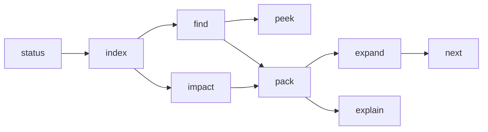

# Using Hivemind from an MCP client

This guide explains the agent workflow. Deployment and connector setup are in [HOSTING.md](HOSTING.md); copy-paste `curl` calls for every tool are in [PLUG-AND-PLAY.md](PLUG-AND-PLAY.md).

---

## 1. The model

Hivemind builds a hierarchical graph of a repository:

- **Code** is split below file level into functions, classes, and methods by Tree-sitter.
- **Documents** such as Markdown, PDF, DOCX, PPTX, XLSX, CSV, and text become section, page, slide, sheet, and file nodes.
- **Memory** notes, facts, decisions, tasks, and signals live in the same tenant database.
- Every node has `L0` (one-line gist), `L1` (summary), and `L2` (authored content). `L3` is a reserved raw-blob pointer and currently falls back to `L2`.

The agent does not read whole files. It asks for a budgeted pack, then expands only what matters.



---

## 2. First run

1. Check the server and the active tenant:

   ```json
   { "tool": "status", "arguments": {} }
   ```

   A new tenant reports `nodes: 0` and an empty workspace.

2. Index the repository:

   ```json
   { "tool": "index", "arguments": { "target": "." } }
   ```

   In stdio, `.` resolves against the `--repo` directory. On the hosted gateway, use a public `https://` Git URL.

3. Run `find` before packing when the symbol or filename is uncertain:

   ```json
   { "tool": "find", "arguments": { "query": "verifyJwt", "budget": 400 } }
   ```

A single indexing pass is enough. Re-run it after large changes.

---

## 3. The core loop

### 3.1 `pack`

```json
{ "tool": "pack", "arguments": { "task": "Fix expired JWT handling in the auth flow", "budget": 1200 } }
```

Output begins with a receipt header:

```text
HIVE_PACK pk_7f3...
Task: Fix expired JWT handling in the auth flow
Budget: 1200 tok | Used: 1043 tok | Slack remaining: 157 tok
Items: 12 | Deferred: 31
[ROI TELEMETRY: Loaded 1043 tok vs 18,420 baseline | Saved 17,377 tok (94.3% reduction)]
```

Each item carries a level, token count, content, and a one-line reason. The 10% slack reserve is intentional: it leaves room for the agent's reasoning and follow-up reads.

The default budget is 2000 tokens. Useful ranges:

| Budget | Use |
|---|---|
| 400 to 600 | Narrow bug fix in one module |
| 800 to 1200 | Normal feature work |
| 1600 to 3000 | Cross-module refactor or architecture question |
| 3000 and above | Work spanning several subsystems |

Bigger is not automatically better. A focused 800-token pack usually beats a 4000-token dump.

### 3.2 `peek` and `expand`

```json
{ "tool": "peek", "arguments": { "node": "c:1a2b...", "depth": 1, "level": "0" } }
{ "tool": "expand", "arguments": { "node": "c:1a2b...", "level": "2" } }
```

- `peek` lists a subtree as TSV at `L0` or `L1`.
- `expand` loads one node at `L1`, `L2`, or `L3`.
- Both end with a `NEXT_HOPS` footer.

Prefer `expand` on a node named in the pack over re-packing with a larger budget.

### 3.3 `explain`

```json
{ "tool": "explain", "arguments": { "node": "c:1a2b..." } }
```

Explains why the node was included or deferred by the latest pack, with composite, lexical, vector, and graph factors. Use it when a pack looks wrong.

### 3.4 `next`

```json
{ "tool": "next", "arguments": { "node": "verifyJwt", "task": "JWT expiry" } }
```

Returns ranked next hops for the relations `implements`, `specifies`, `calls`, `tests`, and `mentions`, plus short cognitive trails.

### 3.5 `impact`

```json
{ "tool": "impact", "arguments": {} }
{ "tool": "impact", "arguments": { "target": "src/auth.ts" } }
```

With no target, it reads the working-tree diff. With a target, it analyzes that file or symbol. On a hosted clone there is no working-tree change, so pass `target`.

---

## 4. Steering the pack

### 4.1 `pin`

```json
{ "tool": "pin", "arguments": { "target": "src/generated/client.ts", "action": "exclude" } }
{ "tool": "pin", "arguments": { "target": "docs/architecture.md", "action": "include" } }
{ "tool": "pin", "arguments": { "target": "docs/architecture.md", "action": "clear" } }
```

Pins accept a path, glob, or symbol and persist in `.hive/overrides.json` for the workspace. On a hosted deployment, re-indexing a Git URL recreates the workspace, so re-apply pins after a re-index.

### 4.2 Task phrasing

The task string drives lexical, semantic, and intent ranking. Name the symptom and the subsystem:

- Good: `Fix expired JWT handling in the auth middleware`
- Weak: `fix bug`
- Good: `Add pagination to the users list API and its tests`
- Weak: `users`

### 4.3 Budget selection

Given a budget $\mathcal{B}$ and slack ratio $\sigma = 0.10$, the pack allocates:

$$
\mathcal{B}_{\text{effective}} = \mathcal{B}(1-\sigma)
$$

The remaining tokens absorb follow-up reads and the agent's own reasoning. If the pack defers the node you need, prefer a pin or a narrower task over doubling the budget.

---

## 5. Persistent memory and coordination

### 5.1 `write`: notes, facts, decisions

```json
{ "tool": "write", "arguments": {
  "parent": "root",
  "kind": "decision",
  "name": "Auth token rotation",
  "content": "Rotate refresh tokens every 30 days; access tokens stay at 15 minutes."
} }
```

`kind` is `note`, `fact`, `decision`, or `tombstone`. Memory nodes participate in search and packs, so a later `pack("why do refresh tokens rotate")` can surface the decision.

Use `tombstone` to mark obsolete knowledge instead of leaving stale facts active.

### 5.2 `task` and `signal`

```json
{ "tool": "task", "arguments": { "verb": "claim", "id": "AUTH-42", "payload": "investigating expiry" } }
{ "tool": "task", "arguments": { "verb": "report", "id": "AUTH-42", "payload": "root cause found" } }
{ "tool": "signal", "arguments": { "channel": "auth", "message": "avoid touching the token cache; migration in progress" } }
```

Tasks are last-writer-wins rows keyed by task ID. A `signal` message is capped at 400 characters, and the response returns the five most recent messages in that channel.

### 5.3 `branch`

```json
{ "tool": "branch", "arguments": { "verb": "fork", "id": "experiment-1" } }
{ "tool": "branch", "arguments": { "verb": "diff", "id": "experiment-1" } }
{ "tool": "branch", "arguments": { "verb": "merge", "id": "experiment-1" } }
```

A branch records a named coordination branch with `fork`, `diff`, `merge`, and `discard`. Branch records do not isolate or copy writes in this release; use them as checkpoints and labels for agent coordination.

---

## 6. Multi-agent patterns

- Use one tenant per project, not per agent. Agents sharing a project should share the tenant so memory, tasks, and signals are visible.
- Claim a task before editing, report when done, and post a signal when changing a shared contract.
- Run `impact` after another agent's change to see what moved.
- Give each agent a modest pack budget and let `next` or `expand` pull the rest on demand.
- Keep pins project-specific and re-apply them after a hosted re-index.

---

## 7. Hosted and stdio behavior

| Capability | Stdio | Hosted gateway |
|---|---|---|
| Index a local directory | Yes | No |
| Index a public Git URL | Yes, with network access | Yes |
| Private repository | Local Git credentials | `X-GitHub-Token` on `/index-repo`, or server-side `GITHUB_TOKEN` |
| Working-tree impact diff | Yes | No working-tree change; pass `target` |
| Pins | Persist in the local workspace | Persist until the Git workspace is recreated |
| Memory and tasks | Local tenant database | Tenant database on the server |
| Interactive graph | Not served | `/graph` |
| Authentication | Local process boundary | `HIVE_API_KEY` |

---

## 8. Failure modes to avoid

- **Packing before indexing.** `status` shows zero nodes; run `index` first.
- **Huge budgets.** They dilute attention and invite low-relevance chunks. Start near 800 and raise only when needed.
- **Ignoring `deferred`.** It lists what was deliberately left out and why. If the needed symbol appears there, pin it or narrow the task.
- **Indexing generated or vendor directories.** Add them to `.gitignore` or pin them as `exclude`. The walker already skips `.git`, `node_modules`, `.venv`, and `__pycache__`.
- **Treating `tenantId` as authentication.** It is a namespace. Use `HIVE_API_KEY` and separate deployments for real isolation.
- **Assuming branch isolation.** Branch records do not fork writes in this release.

---

## 9. Manual invocation

Every tool can be called without an MCP client:

```bash
export HIVE=https://<service>.onrender.com
export KEY=<HIVE_API_KEY>
export TENANT=default

curl -s "$HIVE/mcp?tenantId=$TENANT" \
  -H "Authorization: Bearer $KEY" \
  -H 'content-type: application/json' \
  -H 'accept: application/json, text/event-stream' \
  -d '{"jsonrpc":"2.0","id":1,"method":"tools/call","params":{"name":"status","arguments":{}}}'
```

The complete argument table and one call per tool are in [PLUG-AND-PLAY.md](PLUG-AND-PLAY.md).
