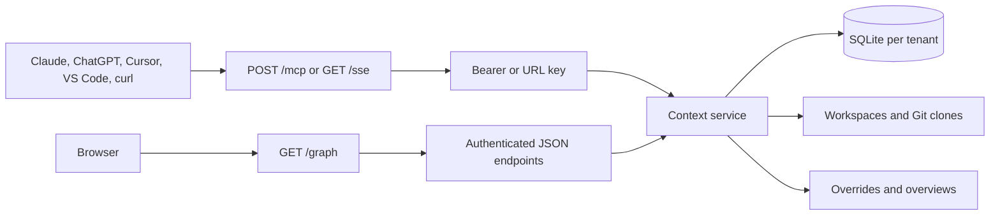
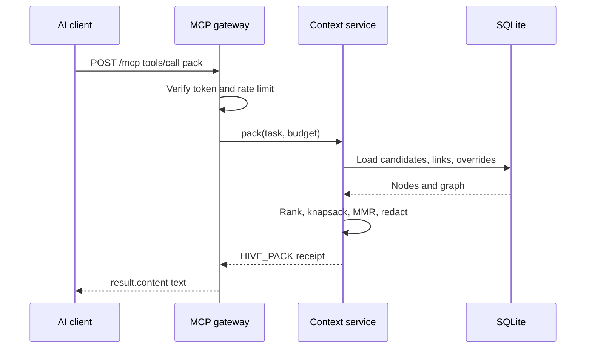

# Plug and Play: one cloud link, every feature

This is the zero-install, cloud-only path. The server runs on a cloud host (Render by default), never on your PC. Every user then talks to **one MCP URL** from Claude, Cursor, VS Code, ChatGPT, Cline, or plain `curl`. Nothing is downloaded and no local process is started on anyone's machine.

- Streamable HTTP: `https://<service>/mcp?tenantId=<project>`
- Legacy SSE: `https://<service>/sse?tenantId=<project>`
- Interactive graph: `https://<service>/graph?tenantId=<project>`

All three share the same database, tools, and tenant namespace.



---

## 1. Deploy once (5 minutes)

### Option A: Render blueprint (recommended, fully managed cloud)

1. Open `https://render.com/deploy?repo=https://github.com/jashjain-1/Hive` (or Render > **New > Blueprint** and pick the repo).
2. Apply `render.yaml`. It builds the Dockerfile in Render's cloud, sets a health check on `/health`, generates `HIVE_API_KEY`, and enables the query-key fallback for connectors that cannot send headers.
3. Wait for the build, then open **Environment** and copy `HIVE_API_KEY`.
4. Check `https://<service>.onrender.com/health` returns `{"status":"healthy",...}`.

Render hosts the process, database, and clones. Nothing is served from your machine. The blueprint uses the free plan: 512 MB RAM, `HIVE_EMBEDDINGS=off`, 3000-file index cap, and an ephemeral disk. Every tool works; state resets when the instance sleeps or redeploys. For durable state, attach a Render Disk, set `HIVE_DATA_ROOT` to the mount path, and keep exactly one instance (SQLite is per process).



### Option B: Docker on any cloud VM

```bash
docker build -t hivemind-mcp .
docker run -d --name hivemind -p 3000:3000 \
  -e HIVE_API_KEY="$(openssl rand -hex 24)" \
  -e HIVE_ALLOW_QUERY_KEY=true \
  -e HIVE_EMBEDDINGS=off \
  -v hivemind-data:/app/.hive \
  hivemind-mcp
```

Run this on Fly.io, Railway, a cloud VM, or any container host, not on a laptop that users depend on. Put TLS in front and disable proxy buffering on `/mcp` and `/sse`.

---

## 2. Connect a client to the link

### Claude (web/Desktop custom connector)

1. **Customize > Connectors > Add custom connector**.
2. Authentication: **No sign-in**.
3. URL (works without the fixed-header beta): `https://<service>/mcp?tenantId=default&apiKey=<HIVE_API_KEY>`. The blueprint sets `HIVE_ALLOW_QUERY_KEY=true`; set it on any other host.
4. If your organization has access to fixed request headers (beta), prefer the cleaner form instead: URL `https://<service>/mcp?tenantId=default` plus header `Authorization: Bearer <HIVE_API_KEY>`.
5. Enable the connector in a conversation and ask it to call `status`.

Claude Desktop's `claude_desktop_config.json` is for **local** stdio servers. Remote servers go through the Connectors UI, so the cloud deployment needs no desktop config file.

### ChatGPT (custom app / connector)

1. Enable developer mode in ChatGPT, then create a custom connector/app.
2. Transport: Streamable HTTP. URL: `https://<service>/mcp?tenantId=default&apiKey=<HIVE_API_KEY>`.
3. Authentication: **No authentication** (the key is in the URL). ChatGPT's documented flow supports OAuth or no-auth, not an arbitrary fixed bearer header.
4. Ask it to call `status`, then `index` with a public Git URL.

This server does not implement an OAuth authorization server, so no-auth plus the URL key is the supported ChatGPT path. Keep the URL private; it is a credential.

### Cursor

Cursor supports custom headers, so keep the key out of the URL:

`.cursor/mcp.json`:

```json
{
  "mcpServers": {
    "hivemind": {
      "url": "https://<service>/mcp?tenantId=default",
      "headers": { "Authorization": "Bearer <HIVE_API_KEY>" }
    }
  }
}
```

### VS Code

VS Code supports custom headers, so keep the key out of the URL:

`.vscode/mcp.json`:

```json
{
  "servers": {
    "hivemind": {
      "type": "http",
      "url": "https://<service>/mcp?tenantId=default",
      "headers": { "Authorization": "Bearer <HIVE_API_KEY>" }
    }
  }
}
```

### Clients that only speak SSE

Use `https://<service>/sse?tenantId=default` and the same bearer header. `POST /messages` follows automatically.

### Tenant selection

Prefer the `X-Hive-Tenant` header over `?tenantId=` so project names stay out of access logs. One tenant per project, shared by every agent working on that project.

---

## 3. First call: index a repository

Hosted servers cannot read a user's local disk, so the index target is a **public `https://` Git URL** (GitHub, GitLab, Bitbucket; configure `HIVE_ALLOWED_HOSTS` for others). Local-path indexing is only available in stdio mode.

Ask the client:

```json
{ "tool": "index", "arguments": { "target": "https://github.com/owner/repo" } }
```

Or call it directly without any MCP client:

```bash
export HIVE=https://<service>.onrender.com
export KEY=<HIVE_API_KEY>
export TENANT=default

curl -s "$HIVE/mcp?tenantId=$TENANT" \
  -H "Authorization: Bearer $KEY" \
  -H 'content-type: application/json' \
  -H 'accept: application/json, text/event-stream' \
  -d '{"jsonrpc":"2.0","id":1,"method":"tools/call","params":{"name":"index","arguments":{"target":"https://github.com/vercel/ms"}}}'
```

The call returns when indexing finishes. Re-run after large changes. `filesSkipped` counts ignored binaries, lockfiles, and oversized files.

Private repository: send `X-GitHub-Token` to `POST /index-repo`, or set a server-side `GITHUB_TOKEN` (which also covers the MCP `index` tool).

---

## 4. The manual invocation contract

Every tool is a single JSON-RPC `tools/call`:

```bash
curl -s "$HIVE/mcp?tenantId=$TENANT" \
  -H "Authorization: Bearer $KEY" \
  -H 'content-type: application/json' \
  -H 'accept: application/json, text/event-stream' \
  -d '{"jsonrpc":"2.0","id":1,"method":"tools/call","params":{"name":"TOOL","arguments":{ ... }}}'
```

The server is stateless per request: no `initialize` handshake and no session id are required for `tools/call` over `/mcp`. A successful result is `result.content[0].text` (always secret-redacted). A tool-level failure is `result.isError: true` with the reason in the same text field.

List the live catalog at any time:

```bash
curl -s "$HIVE/mcp?tenantId=$TENANT" -H "Authorization: Bearer $KEY" \
  -H 'content-type: application/json' \
  -d '{"jsonrpc":"2.0","id":1,"method":"tools/list","params":{}}'
```

### All 14 tools

| # | Tool | `arguments` | What it does / what you get back |
|---|---|---|---|
| 1 | `index` | `{"target":"https://github.com/owner/repo"}` | Clone + index. Returns files/nodes/links counts and warnings. |
| 2 | `status` | `{}` | JSON: tenant, repo root, db path, nodes by tree, indexed files, links, pack receipts, ROI, last index. |
| 3 | `find` | `{"query":"verifyJwt","budget":400}` | Token-budgeted TSV of candidate nodes plus a `NEXT_HOPS` footer. Use it before `peek`/`expand` when you do not know the node id. |
| 4 | `peek` | `{"node":"c:...","depth":1,"level":"0"}` | Subtree at L0/L1. `node` accepts an id, an exact symbol name, or a path fragment. |
| 5 | `expand` | `{"node":"c:...","level":"2"}` | L1 summary, L2 authored content, or L3 blob (falls back to L2). |
| 6 | `pack` | `{"task":"Fix JWT expiry","budget":1200,"explain":true}` | The main entry point: budgeted `HIVE_PACK` with 10% slack, per-item reasons, deferred list, ROI telemetry. |
| 7 | `explain` | `{"node":"c:...","task":"JWT expiry"}` | Why the latest pack included or deferred that node, with factor scores. |
| 8 | `next` | `{"node":"c:...","task":"JWT expiry"}` | Ranked associative next hops and a cognitive trail footer. |
| 9 | `impact` | `{"target":"src/auth.ts"}` or `{}` | Blast radius for a file/symbol. On hosted clones there is no working-tree diff, so pass `target`. |
| 10 | `pin` | `{"target":"**/generated/**","action":"exclude"}` | `include` / `exclude` / `clear` a path, glob, or symbol. Persists in the workspace overrides file. |
| 11 | `write` | `{"parent":"root","kind":"decision","name":"Token rotation","content":"..."}` | Create `note`, `fact`, `decision`, or `tombstone` memory. Memory is searchable and packable. |
| 12 | `task` | `{"verb":"claim","id":"AUTH-42","payload":"investigating"}` | `claim` / `report` / `handoff` coordination rows (last writer wins). |
| 13 | `signal` | `{"channel":"auth","message":"freeze token cache"}` | Append-only blackboard message, capped at 400 characters. Returns the 5 most recent. |
| 14 | `branch` | `{"verb":"fork","id":"experiment-1"}` | `fork` / `diff` / `merge` / `discard` a named branch record. Branches are coordination labels and do not isolate writes in this release. |

Copy-paste examples for the ones with the most knobs:

```bash
# 1. Index
-d '{"jsonrpc":"2.0","id":1,"method":"tools/call","params":{"name":"index","arguments":{"target":"https://github.com/vercel/ms"}}}'

# 2. Status
-d '{"jsonrpc":"2.0","id":2,"method":"tools/call","params":{"name":"status","arguments":{}}}'

# 3. Find
-d '{"jsonrpc":"2.0","id":3,"method":"tools/call","params":{"name":"find","arguments":{"query":"format","budget":400}}}'

# 4. Peek (replace c:... with an id from find)
-d '{"jsonrpc":"2.0","id":4,"method":"tools/call","params":{"name":"peek","arguments":{"node":"c:...","depth":1,"level":"0"}}}'

# 5. Expand
-d '{"jsonrpc":"2.0","id":5,"method":"tools/call","params":{"name":"expand","arguments":{"node":"c:...","level":"2"}}}'

# 6. Pack
-d '{"jsonrpc":"2.0","id":6,"method":"tools/call","params":{"name":"pack","arguments":{"task":"format milliseconds into a human readable string","budget":800,"explain":true}}}'

# 7. Explain
-d '{"jsonrpc":"2.0","id":7,"method":"tools/call","params":{"name":"explain","arguments":{"node":"c:..."}}}'

# 8. Next
-d '{"jsonrpc":"2.0","id":8,"method":"tools/call","params":{"name":"next","arguments":{"node":"c:...","task":"format milliseconds"}}}'

# 9. Impact
-d '{"jsonrpc":"2.0","id":9,"method":"tools/call","params":{"name":"impact","arguments":{"target":"src/index.ts"}}}'

# 10. Pin then clear
-d '{"jsonrpc":"2.0","id":10,"method":"tools/call","params":{"name":"pin","arguments":{"target":"**/index.ts","action":"include"}}}'
-d '{"jsonrpc":"2.0","id":11,"method":"tools/call","params":{"name":"pin","arguments":{"target":"**/index.ts","action":"clear"}}}'

# 11. Write memory
-d '{"jsonrpc":"2.0","id":12,"method":"tools/call","params":{"name":"write","arguments":{"parent":"root","kind":"decision","name":"Verification decision","content":"Written through the hosted link."}}}'

# 12. Task lifecycle
-d '{"jsonrpc":"2.0","id":13,"method":"tools/call","params":{"name":"task","arguments":{"verb":"claim","id":"VERIFY-1","payload":"verifier"}}}'
-d '{"jsonrpc":"2.0","id":14,"method":"tools/call","params":{"name":"task","arguments":{"verb":"report","id":"VERIFY-1","payload":"done"}}}'
-d '{"jsonrpc":"2.0","id":15,"method":"tools/call","params":{"name":"task","arguments":{"verb":"handoff","id":"VERIFY-1","payload":"next agent"}}}'

# 13. Signal
-d '{"jsonrpc":"2.0","id":16,"method":"tools/call","params":{"name":"signal","arguments":{"channel":"verification","message":"all tools reachable over the link"}}}'

# 14. Branch
-d '{"jsonrpc":"2.0","id":17,"method":"tools/call","params":{"name":"branch","arguments":{"verb":"fork","id":"verify-branch"}}}'
-d '{"jsonrpc":"2.0","id":18,"method":"tools/call","params":{"name":"branch","arguments":{"verb":"diff","id":"verify-branch"}}}'
-d '{"jsonrpc":"2.0","id":19,"method":"tools/call","params":{"name":"branch","arguments":{"verb":"merge","id":"verify-branch"}}}'
```

---

## 5. Features that are HTTP endpoints, not tools

| Feature | Call | Returns |
|---|---|---|
| Health | `GET /health` | `{status:"healthy", uptime, activeTenants}`. Public even with auth on. |
| Service map | `GET /` | Endpoint list, auth flag, quickstart. Public. |
| Interactive graph | `GET /graph?tenantId=<id>` | Browser UI: search, tri-state include/exclude, L0/L1/L2 preview, budget meter, hand-off card. Public shell; prompts once for the API key. |
| Graph JSON | `GET /graph.json?tenantId=<id>&task=<task>` | Nodes, links, stats and relevance scores for custom UIs. |
| Node detail | `GET /graph/node?tenantId=<id>&id=<node>` | L0/L1/L2 content, links, token counts. |
| Session overview | `GET /graph-overview?tenantId=<id>&task=<task>` | Full `GRAPH_OVERVIEW.md`: stats, top files, hub symbols, Mermaid map. |
| Chat-start card | `GET /chat-start?tenantId=<id>&task=<task>` | Compact card to paste at the top of a chat. |
| Index status | `GET /index-status?tenantId=<id>` | Same payload as the `status` tool. |
| Context bundle | `POST /graph/context-pack` | Server-side pack of `{included, excluded, budget, task}` with Markdown. |
| Index by URL | `POST /index-repo` | `{repoUrl, tenantId}`; supports `X-GitHub-Token`. |

```bash
curl -s "$HIVE/graph-overview?tenantId=$TENANT" -H "Authorization: Bearer $KEY"
curl -s "$HIVE/chat-start?tenantId=$TENANT&task=auth%20bug" -H "Authorization: Bearer $KEY"
curl -s "$HIVE/index-status?tenantId=$TENANT" -H "Authorization: Bearer $KEY"
curl -s -X POST "$HIVE/index-repo?tenantId=$TENANT" \
  -H "Authorization: Bearer $KEY" -H 'content-type: application/json' \
  -d '{"repoUrl":"https://github.com/vercel/ms","tenantId":"default"}'
```

---

## 6. Prove the deployment

One command exercises all 14 tools and every REST endpoint against the live link. It needs Node 20+ on the operator's machine only, not on the user's. The same suite is what the repository itself reports: 60 unit and protocol tests, 11 end-to-end checks, and 21 live-link checks.

A pack respects a 10% reserve, so the usable budget for $\mathcal{B}$ input tokens is:

$$
\mathcal{B}_{\text{effective}} = \mathcal{B}(1-\sigma), \qquad \sigma = 0.10
$$

```bash
BASE_URL=https://<service>.onrender.com \
API_KEY=<HIVE_API_KEY> \
REPO_URL=https://github.com/vercel/ms \
node scripts/verify-hosted-tools.mjs
```

Expected tail: `[verify] 21/21 checks passed`.

Symptom > cause:

| Symptom | Fix |
|---|---|
| `401 Unauthorized` | Missing/wrong `Authorization: Bearer <HIVE_API_KEY>`. |
| `Repository host is not allowed` | Add the host to `HIVE_ALLOWED_HOSTS`. Only `https://` URLs work. |
| `git clone failed` | Private repo: set `GITHUB_TOKEN` on the server or send `X-GitHub-Token` to `/index-repo`. |
| Index stops at 5000 files | Raise `HIVE_MAX_FILES` or index a subdirectory. |
| First request after idle times out | Render cold start; retry once. |
| Graph shows an API-key prompt | Expected when `HIVE_API_KEY` is set. Paste the key; it is kept in `sessionStorage` for that tab. |
| Data vanished after restart | Free-tier disk is ephemeral. Re-index, or attach a persistent disk and set `HIVE_DATA_ROOT`. |

---

## 7. What "all features" means here

- The server, SQLite database, Git clones, and graph UI all run on the cloud host. No part of the deployed service depends on your PC being online.
- All 14 tools are available identically over `/mcp` and `/sse`; stdio remains an optional offline mode, not a requirement.
- Indexing, search, packing, explainability, next-hop navigation, impact analysis, pins, memory writes, tasks, signals, and branches are verified through the cloud link (`scripts/verify-hosted-tools.mjs`).
- The graph UI, overview, chat-start card, status, and context-pack endpoints are verified the same way.
- Hosted indexing requires a Git URL because the cloud server cannot read a user's local disk. Local paths work only in stdio; `index` with a local path is intentionally rejected on the gateway.
- Two secondary differences follow from the cloud model: `impact` needs an explicit `target` because there is no working-tree diff, and pins live in the indexed workspace, so a Git re-index clears them.
- Free-tier disks are ephemeral. Attach a persistent disk for state that must survive restarts; this is a hosting-plan property, not a code path that needs your PC.
- The API key authenticates the whole deployment. Tenant IDs are namespaces, not per-user credentials; use separate deployments for separate trust boundaries.

## 8. Auth modes at a glance

| Caller | Auth it supports | What to use |
|---|---|---|
| Cursor, VS Code, curl, custom agents | `Authorization` header | `HIVE_API_KEY` + `-H "Authorization: Bearer ..."` |
| Claude connectors (header beta) | Fixed request header | URL without key + `Authorization` request header |
| Claude connectors (no header beta) | No-auth + URL | `?apiKey=<key>` with `HIVE_ALLOW_QUERY_KEY=true` (set by the blueprint) |
| ChatGPT apps | OAuth or no-auth | `?apiKey=<key>` with **No authentication** |
| Browser graph UI | Prompt | Paste the key once; it stays in `sessionStorage` for that tab |

`HIVE_ALLOW_QUERY_KEY=true` means the key can appear in proxy and access logs. That is the trade-off for clients that cannot send headers. Prefer header auth wherever the client supports it.
